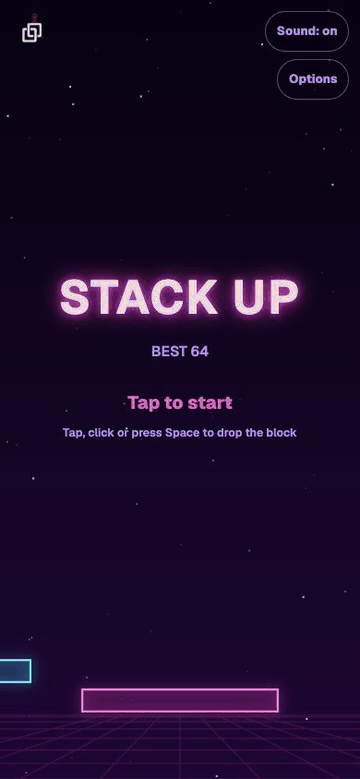
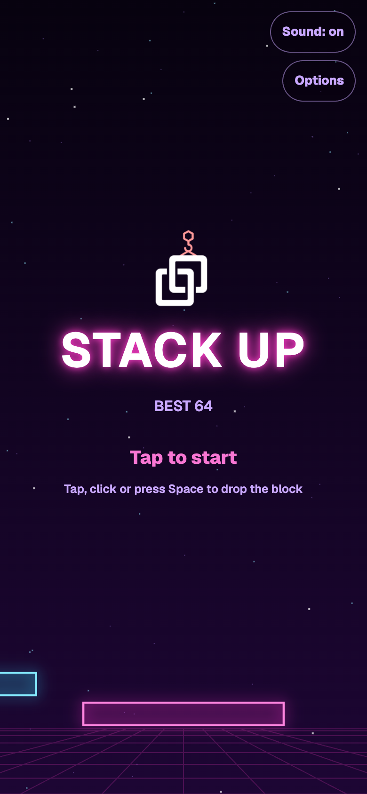
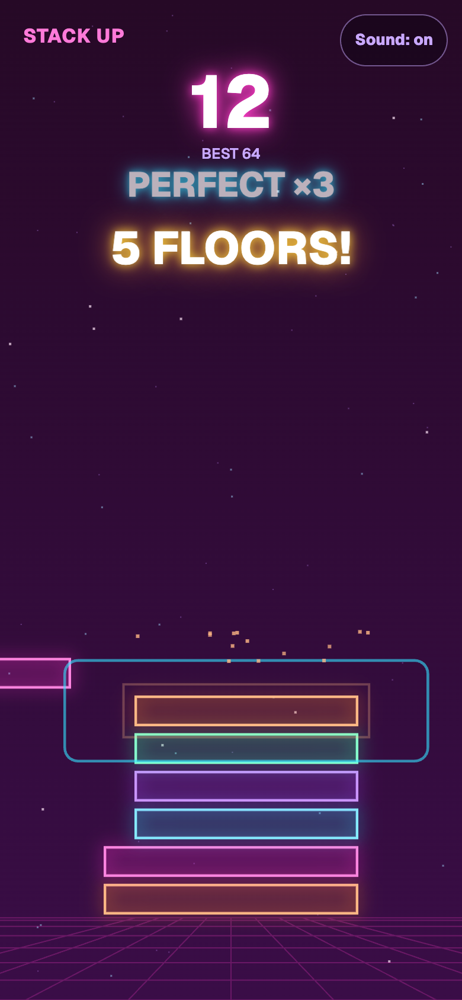
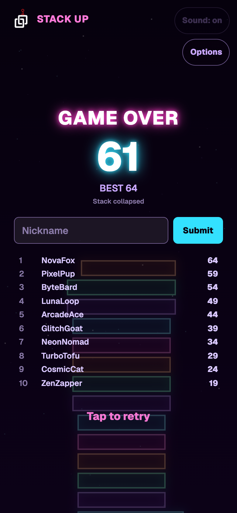
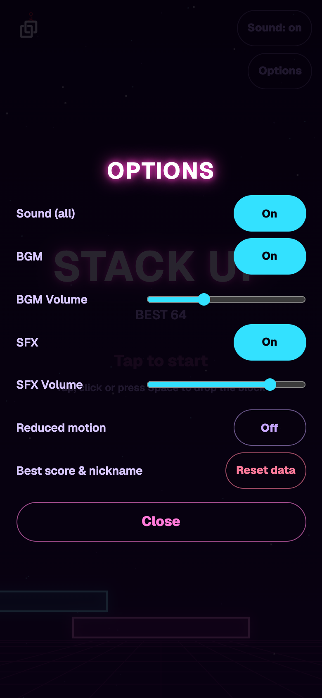

<p align="center">
  
</p>

# Arcade-Web

Small browser games for [devcol.net](https://devcol.net), built with TypeScript, Canvas 2D and WebAudio. No game engine or framework, no external CDN, and no audio files: every sound is synthesized in code.

Unity games live in a separate repository (`devcol-arcade`).

## Games

| Game | Status | Folder |
|---|---|---|
| **Stack Up** | Playable | [`games/stack-up`](games/stack-up) |
| Bug Squash | Planned | |

### Stack Up

A one-tap stacking game. A block slides back and forth across the screen; tap (or press Space) to drop it. Whatever overhangs the block below is sliced off and falls away. Miss completely and the stack collapses.

- **Perfect** drops snap into place without cutting. Chain them for combos, and every 5th Perfect in a row regrows the block.
- Speed rises with every floor (up to a cap), and the camera follows the tower up.
- Milestones at 5, 10, 20, 30 ... floors get a popup, a sound and a background flash.
- Neon look: glow sprites are pre-rendered (no per-frame `shadowBlur`), parallax star layers, particles and square shockwaves on Perfect.
- Synthesized BGM and sound effects, with separate BGM/SFX toggles and volumes.
- Best score (HUD, title, `NEW BEST`) and a local Top 10 leaderboard with nicknames.
- Options panel: audio, manual reduced motion (also honors the OS setting), and a two-step data reset.
- Pauses when the tab is hidden; works in an iframe and on portrait phones.

**Controls:** click / tap / `Space` to drop, `M` to mute everything, `Esc` closes the options panel.

| Title | Playing | Game over | Options |
|:---:|:---:|:---:|:---:|
|  |  |  |  |

The screenshots and the GIF are generated by [`scripts/capture-media.mjs`](scripts/capture-media.mjs) (`npm run media`), which plays a seeded run with a bot in headless Chrome. Re-run it after visual changes. The leaderboard names in them are made-up samples.

## Getting started

Requires Node.js 24 (see [`.nvmrc`](.nvmrc)).

```bash
npm ci
npm run dev        # Stack Up at http://localhost:5173
```

Other scripts:

| Command | What it does |
|---|---|
| `npm run dev [-- <game>]` | Dev server for one game (default: `stack-up`) |
| `npm run check` | `tsc --noEmit` + Vitest |
| `npm test` | Vitest only |
| `npm run build [-- <game>]` | Production build to `dist/<game>/` (relative paths, no CDN) |
| `npm run media` | Regenerates the README screenshots and GIF in `docs/media/` (needs Chrome and `ffmpeg`) |

Check the bundle size after a build:

```bash
du -sh dist/stack-up
```

## Project layout

```
games/<game>/
  index.html
  src/core/     pure game logic (no DOM, Canvas, Audio or storage); seeded RNG, dt-driven
  src/view/     Canvas rendering, camera, background, VFX, glow sprite cache
  src/audio/    WebAudio synthesis, BGM scheduler, audio settings
  src/ui/       screen flow, HTML overlays, options, records
  src/main.ts   game loop and input
  tests/        Vitest
shared/
  leaderboard/  LeaderboardService interface + LocalLeaderboardService (localStorage)
scripts/        build, dev server, copy-to-site, capture-media
docs/
  tasks/        one spec per task (NNN-*.md)
  pipeline-log.md
  assets.md     source and license of every bundled asset
  media/        README screenshots and GIF (generated)
```

Tuning values live in each game's `config` files (`core/config.ts`, `view/viewConfig.ts`, `audio/audioConfig.ts`, `ui/uiConfig.ts`) rather than in the logic.

## Embedding on the site

The builds are static files. After `npm run build`, copy a game into the site repository (expected next to this one as `../devcol-site`):

```bash
npm run build -- stack-up
scripts/copy-to-site.sh stack-up   # -> ../devcol-site/devcol-build/docs/public/games/stack-up

npm run build -- bug-squash
scripts/copy-to-site.sh bug-squash # -> ../devcol-site/devcol-build/docs/public/games/bug-squash
```

Then embed it from a VitePress page with an `<iframe>`.

## Development workflow

Work is organized as numbered task specs in [`docs/tasks`](docs/tasks), each built on a `task/NNN-<name>` branch in small sub-tasks (core + tests, view, effects/audio, UI), each one checked with `npm run check` and reviewed before it is committed. [`docs/pipeline-log.md`](docs/pipeline-log.md) records every sub-task, and [`CLAUDE.md`](CLAUDE.md) holds the project rules (code conventions, loop limits, commit rules).

## Licenses

- Code: [Apache License 2.0](LICENSE). See [`NOTICE`](NOTICE).
- Font: Geist, SIL Open Font License 1.1, bundled with its license at `games/stack-up/public/licenses/`.
- Audio: none bundled; all sounds are generated at runtime.
- DevCol logo (`games/stack-up/src/assets/devcol-logo.png` and its dark-background variant `devcol-logo-dark.png`): owned by DevCol; the logo and brand are not licensed for reuse under Apache-2.0 (see [`docs/assets.md`](docs/assets.md)).

Only assets that are free for commercial use are accepted, and each one is recorded in [`docs/assets.md`](docs/assets.md).
